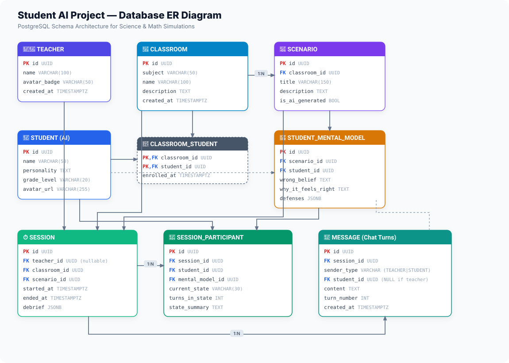

# Database Schema & Entity Relationship (ER) Diagram



---

## 1. Visual Architecture Map (Text Box Layout)

```
       +--------------------+
       |      TEACHER       | (Name + Avatar Badge, no passwords)
       +--------------------+
                 |
                 | hosts (1:N)
                 v
+----------------------------------------------------------------------------------+
|                                    CLASSROOM                                     |
|                      (e.g., Science, Math, Literacy)                             |
+----------------------------------------------------------------------------------+
        |                                                     |
        | enrolled (M:N)                                      | contains (1:N)
        v                                                     v
+--------------------+                               +--------------------+
|      STUDENT       |                               |      SCENARIO      |
|  (Sue, Marcus...)  |<------------------------------| (Sam & Anthony...) |
+--------------------+   defines wrong belief for     +--------------------+
   |          |          (M:N with defenses)                  |
   |          |                                               |
   |          +--------------+                                |
   |                         |                                |
   | attends (1:N)           |                                | runs in (1:N)
   v                         v                                v
+----------------------------------------------------------------------------------+
|                                     SESSION                                      |
|                       (Teacher + Classroom + Scenario)                           |
+----------------------------------------------------------------------------------+
          |                                               |
          | seats students (1:N)                          | logs chat turns (1:N)
          v                                               v
+-------------------------------+               +----------------------------------+
|      SESSION_PARTICIPANT      |               |             MESSAGE              |
|-------------------------------|               |----------------------------------|
| * student_id (Sue)            |               | * sender_type (TEACHER | STUDENT)|
| * current_state (e.g. CONFUSED|               | * student_id (Sue / NULL)        |
| * turns_in_state (e.g. 2)     |               | * content (chat text)            |
| * mental_model_id (wrong idea)|               | * turn_number (1, 2, 3...)       |
+-------------------------------+               +----------------------------------+
```

---

## 2. Table Summary

| Table | Purpose | Key Columns |
|---|---|---|
| **`teacher`** | Real user profile (no password) | `id`, `name`, `avatar_badge` (`fox`, `otter`, `owl`, `panda`) |
| **`classroom`** | Course / subject container | `id`, `subject` (`SCIENCE`, `MATH`), `name` |
| **`student`** | AI student persona (cross-classroom) | `id`, `name` (Sue), `personality`, `grade_level` |
| **`classroom_student`**| Student classroom enrollment (M:N) | `classroom_id`, `student_id` |
| **`scenario`** | Classroom problem/story | `id`, `classroom_id`, `title`, `description`, `is_ai_generated` |
| **`student_mental_model`**| What student believes wrong in this scenario | `id`, `scenario_id`, `student_id`, `wrong_belief`, `defenses` |
| **`session`** | A teaching lesson instance | `id`, `teacher_id`, `classroom_id`, `scenario_id`, `started_at` |
| **`session_participant`** | Live state of a student in session | `session_id`, `student_id`, `current_state`, `turns_in_state` |
| **`message`** | Ordered chat dialogue turn | `session_id`, `sender_type` (TEACHER/STUDENT), `student_id`, `turn_number` |

---

## 3. Direct SVG File
If your markdown preview does not render inline images, you can directly open:
* [`ddl/er_diagram.svg`](file:///Users/sanket/Desktop/Opi%20/student-ai-project/ddl/er_diagram.svg)
* Or open it in any web browser (`open ddl/er_diagram.svg`).
