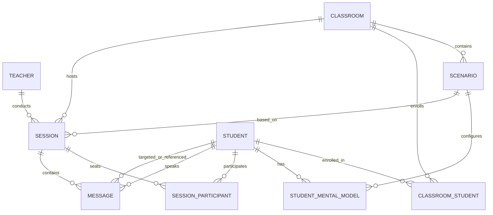
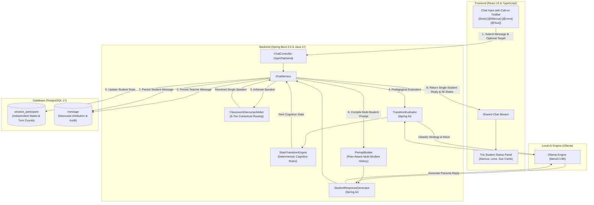
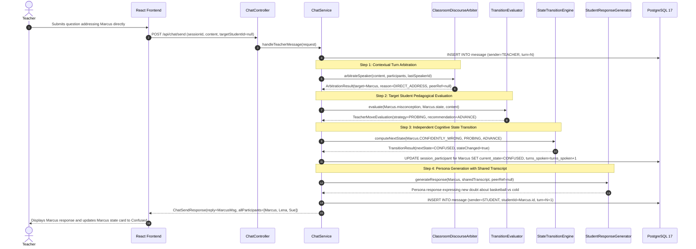
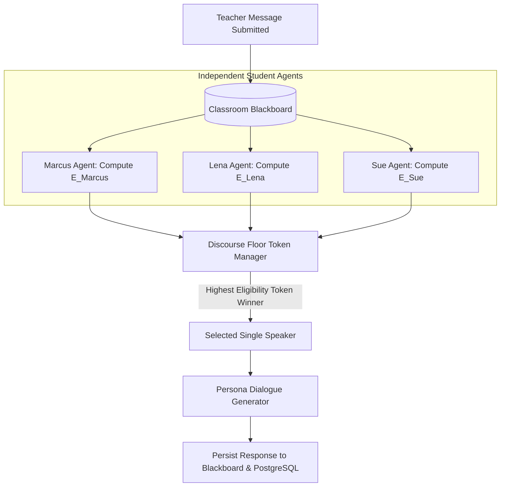
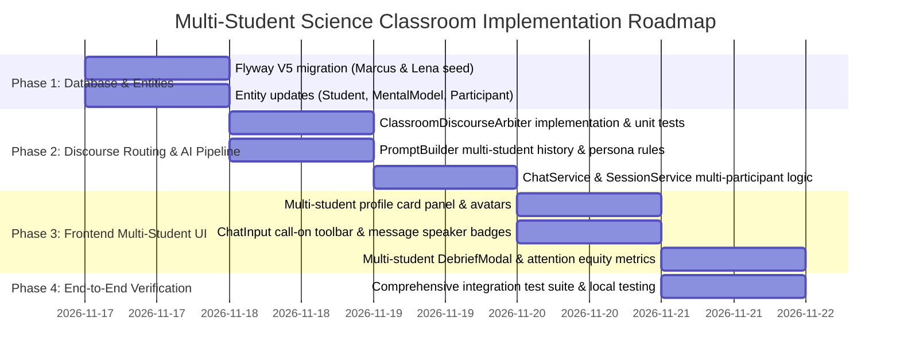

# Multi-Student Science Classroom — Architectural Design Document

**Document Version:** 2.0.0  
**Target Project:** Student AI Project (`student-ai-project`)  
**Scope:** Architecture and Database Redesign for a 3-Student Collaborative Science Classroom (*Marcus, Lena, Sue*) with Independent Mental Models, Discourse Routing, Contextual Name Recognition, and Turn-by-Turn Cognitive Analytics.

---

## 1. Executive Summary & Design Vision

The **Student AI Project** is evolving from a 1-on-1 tutor simulator into a **multi-student classroom discourse environment**. In this classroom, the user (as Teacher) interacts with three distinct 8th-grade AI students seated in the same room discussing a shared science scenario (*"Disease Transmission: The Basketball Game"*):

1. **Marcus:** Energetic, enthusiastic, talkative (**40%** unaddressed participation frequency), starts **Confidently Wrong** (asserts basketball fatigue caused Anthony's cold).
2. **Lena:** Quiet, observant, overwhelmed (**20%** unaddressed participation frequency), starts **Confused** (puzzled by how illness spreads or if fatigue and germs interact).
3. **Sue:** Gifted, intellectually curious, strong-willed (**40%** unaddressed participation frequency), starts **Tentatively Correct** (suspects viral transmission from Sam, but testing the incubation delay).

### Non-Negotiable Invariants & Supervisor Constraints
1. **One Shared Transcript:** All 3 students hear and see the same discussion, including all prior teacher questions, explanations, and peer contributions.
2. **Strict Single-Speaker Constraint:** Exactly **one** student speaks per teacher turn. After speaking, that student yields the floor. No spontaneous or cascading chatter between AI students. The teacher always controls when the next turn begins.
3. **Contextual Name Recognition:** The system distinguishes:
   - *Direct address* (*"Marcus, why do you think Anthony became sick?"* $\rightarrow$ Marcus speaks).
   - *Peer opinion / Exclusionary query* (*"Does anyone agree with Marcus?"* $\rightarrow$ Marcus is the topic; Lena or Sue must respond).
   - *Direct invitation discussing a peer* (*"Sue, what do you think about Marcus's explanation?"* $\rightarrow$ Sue speaks, explicitly addressing Marcus's argument).
   - *Passive observation* (*"Marcus and Sue both mentioned sports."* $\rightarrow$ Open class reflection; neither is forced to speak).
   - *Open-class question* (*"Why do you think Anthony got sick?"* $\rightarrow$ 40% Marcus / 20% Lena / 40% Sue, adjusted by recency damping).
4. **Independent Mental Models:** Cognitive advancement is strictly decoupled. If Sue reaches `UNDERSTANDING`, Marcus and Lena do not automatically advance. Each student progresses only through their own demonstrated reasoning.
5. **Peer Awareness Without Blind Conformity:** Students listen to their classmates and can reference them, but interpret all ideas through their own cognitive state and personality.

---

## 2. Requirements & Student Persona Specifications

```
                     ┌──────────────────────────────────────────────┐
                     │          TEACHER (Human User)                │
                     └──────────────────────┬───────────────────────┘
                                            │ Single Turn / Prompt
                                            ▼
┌────────────────────────────────────────────────────────────────────────────────────────┐
│                        SHARED CLASSROOM DISCOURSE                                      │
├───────────────────────────────┬───────────────────────────────┬────────────────────────┤
│           MARCUS              │             LENA              │          SUE           │
│ • State: Confidently Wrong 🔴 │ • State: Confused 🟡          │ • State: Tentative 🔵  │
│ • Weight: 40%                 │ • Weight: 20%                 │ • Weight: 40%          │
│ • "Basketball fatigue caused  │ • "Unsure how a cold travels  │ • "Anthony caught the  │
│    the cold directly!"        │    or if fatigue sparked it." │    virus from Sam."    │
│ • Energetic, attention-seeking│ • Quiet, careful, overwhelmed │ • Gifted, incisive     │
└───────────────────────────────┴───────────────────────────────┴────────────────────────┘
```

### Detailed Persona Profiles

| Attribute | Marcus | Lena | Sue |
|---|---|---|---|
| **Personality** | Energetic, enthusiastic, eager for approval, talks frequently, makes spontaneous connections. | Quiet, observant, responsible, overwhelmed, speaks only when having a meaningful thought. | Gifted, intellectually curious, strong opinions, defensive when bluntly challenged, analytical. |
| **Initial State** | `CONFIDENTLY_WRONG` | `CONFUSED` | `TENTATIVELY_CORRECT` |
| **Initial Belief** | Physical exhaustion from playing basketball in the cold gym directly caused Anthony's cold. | Unclear how transmission works. Puzzled why Sam got sick first and Anthony only after basketball. | Anthony contracted a virus from Sam in class, but testing why symptoms appeared days later. |
| **Unaddressed Weight** | **40%** | **20%** | **40%** |
| **Reaction to Peers** | Readily builds on or disputes peers with excitement; wants to be validated by the teacher. | Listens carefully to Marcus and Sue; easily intimidated by fast explanations; needs gentle encouragement. | Critiques Marcus's simplistic correlation; willing to debate; synthesizes evidence. |
| **Avatar Asset** | `/images/avatar_marcus.png` | `/images/avatar_lena.png` | `/images/avatar_sue.png` |

---

## 3. Database Schema Redesign (PostgreSQL 17 + Flyway)

Given full architectural freedom, we enhance the schema to support multi-student discourse tracking, turn attribution, per-student metrics, and cognitive state history.



### Migration: `V5__multi_student_architecture.sql`

```sql
-- ============================================================================
-- V5__multi_student_architecture.sql
-- Upgrades schema to support 3-student classroom discourse and state analytics
-- ============================================================================

-- 1. Enhance student table with discourse weights
ALTER TABLE student
ADD COLUMN IF NOT EXISTS participation_weight INT NOT NULL DEFAULT 40,
ADD COLUMN IF NOT EXISTS speaking_style TEXT;

-- 2. Enhance student_mental_model with initial_state and target concepts
ALTER TABLE student_mental_model
ADD COLUMN IF NOT EXISTS initial_state VARCHAR(30) NOT NULL DEFAULT 'CONFIDENTLY_WRONG',
ADD COLUMN IF NOT EXISTS target_concept TEXT;

-- 3. Enhance session_participant with discourse statistics
ALTER TABLE session_participant
ADD COLUMN IF NOT EXISTS turns_spoken INT NOT NULL DEFAULT 0,
ADD COLUMN IF NOT EXISTS last_spoke_at_turn INT;

-- 4. Enhance message with routing attribution and student state audit
ALTER TABLE message
ADD COLUMN IF NOT EXISTS target_student_id UUID REFERENCES student(id) ON DELETE SET NULL,
ADD COLUMN IF NOT EXISTS referenced_student_id UUID REFERENCES student(id) ON DELETE SET NULL,
ADD COLUMN IF NOT EXISTS routing_reason VARCHAR(50),
ADD COLUMN IF NOT EXISTS student_state_snapshot VARCHAR(30);

-- 5. Seed Marcus and Lena
INSERT INTO student (id, name, personality, grade_level, avatar_url, participation_weight, speaking_style)
VALUES 
    (
        '00000000-0000-0000-0000-000000000020',
        'Marcus',
        'Energetic, enthusiastic, and eager to participate. Most talkative student in the classroom. Wants the teacher''s attention and approval. Sometimes makes unexpected connections.',
        '8th Grade',
        '/images/avatar_marcus.png',
        40,
        'Speaks quickly with excitement, using exclamation points and eager phrases.'
    ),
    (
        '00000000-0000-0000-0000-000000000030',
        'Lena',
        'Quiet, observant, and responsible. The quietest student in the classroom. Takes assignments seriously. Doesn''t speak unless she has something meaningful to contribute. Sometimes struggles to keep up because she is tired or overwhelmed.',
        '8th Grade',
        '/images/avatar_lena.png',
        20,
        'Speaks hesitantly with careful punctuation, often pausing with ellipses.'
    )
ON CONFLICT (id) DO UPDATE SET
    personality = EXCLUDED.personality,
    participation_weight = EXCLUDED.participation_weight;

-- Update Sue's personality and weight
UPDATE student
SET personality = 'Gifted and intellectually curious. Has strong opinions. Can become defensive when challenged. Makes connections and questions explanations.',
    participation_weight = 40,
    avatar_url = '/images/avatar_sue.png',
    speaking_style = 'Incisive, analytical, questions peer reasoning directly.'
WHERE id = '00000000-0000-0000-0000-000000000010';

-- 6. Enroll Marcus and Lena in 8th Grade Science Classroom
INSERT INTO classroom_student (classroom_id, student_id)
VALUES 
    ('00000000-0000-0000-0000-000000000001', '00000000-0000-0000-0000-000000000020'),
    ('00000000-0000-0000-0000-000000000001', '00000000-0000-0000-0000-000000000030')
ON CONFLICT (classroom_id, student_id) DO NOTHING;

-- 7. Seed Mental Models for all 3 students with distinct initial states
-- Sue: Tentatively Correct
UPDATE student_mental_model
SET initial_state = 'TENTATIVELY_CORRECT',
    wrong_belief = 'Anthony caught the virus from Sam when they worked together in class, but unsure why it took days to feel sick.',
    why_it_feels_right = 'She knows viruses spread between people, but the delay between classroom exposure and basketball game onset is puzzling.',
    target_concept = 'Viral incubation period and pathogen multiplication delay.'
WHERE student_id = '00000000-0000-0000-0000-000000000010' 
  AND scenario_id = '00000000-0000-0000-0000-000000000100';

-- Marcus: Confidently Wrong
INSERT INTO student_mental_model (id, scenario_id, student_id, wrong_belief, why_it_feels_right, defenses, initial_state, target_concept)
VALUES (
    '00000000-0000-0000-0000-000000002000',
    '00000000-0000-0000-0000-000000000100',
    '00000000-0000-0000-0000-000000000020',
    'Anthony got sick because he played basketball too hard in the cold gym. Physical tiredness directly caused the cold.',
    'He was running all over the court, missing shots, and sweating. That wears down your body and creates a cold.',
    '["When you run hard in sports, your immune system crashes and you get sick.", "He was fine until the coach made him play!", "If basketball didn''t cause it, why did he feel tired during the game?"]'::jsonb,
    'CONFIDENTLY_WRONG',
    'Distinction between correlation (tired during game) and causation (pathogen transmission).'
) ON CONFLICT (scenario_id, student_id) DO NOTHING;

-- Lena: Confused
INSERT INTO student_mental_model (id, scenario_id, student_id, wrong_belief, why_it_feels_right, defenses, initial_state, target_concept)
VALUES (
    '00000000-0000-0000-0000-000000003000',
    '00000000-0000-0000-0000-000000000100',
    '00000000-0000-0000-0000-000000000030',
    'Unsure how illness spreads. Wondering if being around Sam could cause a cold days later or if basketball fatigue triggered it.',
    'Sam was sick first, but Anthony didn''t get sick until after playing basketball, so both seem related.',
    '["I don''t understand how germs travel across a desk without you knowing.", "Could basketball have activated Sam''s germs?"]'::jsonb,
    'CONFUSED',
    'Microscopic airborne transmission and the timeline of viral replication.'
) ON CONFLICT (scenario_id, student_id) DO NOTHING;
```

---

## 4. Proposed Design A: Discourse Orchestrator with Contextual Arbiter & Teacher UI Co-Pilot (Recommended)

### 4.1 Concept & Philosophy
Design A decouples **Discourse Routing** from **Persona Generation**. Turn arbitration runs as a fast, deterministic, testable pipeline that recognizes conversational context, while the Teacher is given a flexible UI Co-Pilot to override routing whenever desired.

### 4.2 System Architecture Component Diagram

The diagram below details the components across the Frontend, Spring Boot Backend, Local AI Engine, and PostgreSQL Database:



### 4.3 End-to-End Execution Sequence Diagram

The sequence diagram below traces a single dialogue turn where the teacher directly addresses Marcus:



### 4.4 Detailed Routing Logic (`ClassroomDiscourseArbiter.java`)

The arbiter processes 5 distinct tiers in order of strict precedence:

```java
@Component
public class ClassroomDiscourseArbiter {

    private static final Pattern DIRECT_VOCATIVE = Pattern.compile(
        "(?i)(?:^|[.?!]\\s*)(?:hey\\s+|hi\\s+|so\\s+)?(marcus|lena|sue)\\b[,:?\\s]"
    );

    private static final Pattern PEER_EXCLUSION_QUERY = Pattern.compile(
        "(?i)\\b(agree|disagree|think of|think about|different from|what about)\\s+(?:what\\s+)?(marcus|lena|sue)\\b"
    );

    private static final Pattern INVITATION_WITH_PEER = Pattern.compile(
        "(?i)(marcus|lena|sue)\\b.*?(?:what\\s+do\\s+you\\s+think\\s+(?:of|about)|reaction\\s+to)\\s+(marcus|lena|sue)\\b"
    );

    public ArbitrationResult arbitrate(
            String text,
            UUID explicitTargetId,
            List<SessionParticipant> participants,
            UUID lastSpeakerId
    ) {
        // Tier 1: Manual UI Chip Override
        if (explicitTargetId != null) {
            return resolveParticipant(explicitTargetId, participants, "MANUAL_TEACHER_SELECTION", null);
        }

        // Tier 2: Direct Invitation Referencing a Peer ("Sue, what do you think of Marcus's explanation?")
        Matcher invMatcher = INVITATION_WITH_PEER.matcher(text);
        if (invMatcher.find()) {
            String invited = invMatcher.group(1);
            String referenced = invMatcher.group(2);
            return resolveByName(invited, participants, "DIRECT_INVITATION_REFERENCING_PEER", referenced);
        }

        // Tier 3: Peer Exclusion Query ("Does anyone agree with Marcus?")
        Matcher peerMatcher = PEER_EXCLUSION_QUERY.matcher(text);
        if (peerMatcher.find()) {
            String excludedName = peerMatcher.group(2);
            return pickExcludingPeer(excludedName, participants, lastSpeakerId, "PEER_EXCLUSION_QUERY");
        }

        // Tier 4: Direct Vocative Address ("Marcus, what do you think?")
        Matcher vocMatcher = DIRECT_VOCATIVE.matcher(text);
        if (vocMatcher.find()) {
            String name = vocMatcher.group(1);
            return resolveByName(name, participants, "DIRECT_VOCATIVE_ADDRESS", null);
        }

        // Tier 5: Open Class Weighted Distribution with Recency Damping
        return pickStochasticWeighted(participants, lastSpeakerId);
    }
}
```

#### Recency Damping Algorithm
When selecting from candidates (open question or peer exclusion):
- Base weights: $W_{Marcus} = 0.40$, $W_{Sue} = 0.40$, $W_{Lena} = 0.20$.
- If candidate $C$ was the last student to speak, its weight is penalized:
  $$W'_C = W_C \times 0.35$$
- The remaining weight is normalized across the other two students. This prevents Marcus or Sue from monopolizing 4 turns in a row while strictly respecting the 40/20/40 aggregate distribution over an entire 15-turn session.

---

## 5. Proposed Design B: Blackboard Pattern with Multi-Agent Discourse Arbitration

### 5.1 Concept & Philosophy
In this design, the classroom is modeled as an **autonomous multi-agent blackboard system**. When the Teacher speaks, the message is posted to a shared **Discourse Blackboard**. 

Instead of a single central arbiter picking a student, **all three student agents evaluate their own eligibility score ($E_i \in [0.0, 1.0]$)** concurrently based on:
1. Did the teacher mention my name? ($+0.9$)
2. Was my peer's idea mentioned and do I hold an opposing belief? ($+0.4$)
3. Am I naturally quiet (Lena) and feel overwhelmed? ($-0.3$)
4. Did I just speak on the previous turn? ($-0.5$)
5. Base talkativeness propensity (Marcus $0.8$, Sue $0.8$, Lena $0.4$).

The agent with the highest eligibility score claims the floor token.

### 5.2 Architecture Diagram



### 5.3 Eligibility Scoring Model
For student $i$:
$$E_i = \text{BasePropensity}_i + \text{DirectAddressScore}_i + \text{TopicRelevance}_i - \text{FatiguePenalty}_i - \text{RecencyPenalty}_i + \epsilon$$
- $\epsilon \sim \mathcal{N}(0, 0.05)$ provides natural behavioral variability.
- If $E_{max} > \text{Threshold}$, the winning agent is granted the floor.
- **Supervisor Invariant Enforcement:** The Floor Manager guarantees that **only the winning agent runs inference**, completely preventing cascading replies.

### 5.4 Comparison of Designs

| Dimension | Design A: Discourse Orchestrator + Co-Pilot | Design B: Blackboard Multi-Agent Eligibility |
|---|---|---|
| **Routing Determinism** | 100% predictable; transparent rule chain | Heuristic scoring with stochastic variance |
| **Execution Latency** | **$<1\text{ ms}$ (instant regex + weighted draw)** | ~5–10ms (score computation across 3 agents) |
| **Linguistic Precision** | High for standard vocatives and peer questions | High for complex semantic relevance |
| **Teacher Override Agency** | Direct UI call-on chips (`[@Marcus]`, etc.) | Direct UI override or auto-bidding |
| **Testability** | **Extremely simple with JUnit parameterized tests** | Requires scoring matrix simulation tests |
| **Implementation Complexity** | Clean, modular, easy to maintain | Higher complexity (agent abstraction layer) |

---

## 6. Multi-Student Prompt Architecture & Peer Independence

### 6.1 Shared Conversation History Formatting
In [`PromptBuilder.buildConversationHistory()`](file:///Users/sanket/Desktop/Opi%20/student-ai-project/backend/src/main/java/com/studentai/project/ai/PromptBuilder.java), all messages are prepended with the exact speaker's name:

```text
Teacher: Why do you think Anthony became sick?
Marcus: Maybe he got sick because he was playing basketball and got too tired!
Teacher: Sue, what do you think about Marcus's explanation?
Sue: I don't think tiredness causes viruses out of nowhere. Remember Sam had a severe cold in class a few days earlier?
Teacher: Lena, does that make sense to you?
```

### 6.2 Persona System Prompt with Peer Independence
When prompting Ollama to embody the selected student, the system prompt explicitly enforces non-conformity:

```text
=== YOUR IDENTITY & PEERS ===
You are [StudentName] in an 8th-grade science classroom.
Your classmates sitting next to you are:
- Marcus: Energetic, enthusiastic, eager to participate, talkative.
- Lena: Quiet, thoughtful, observant, easily overwhelmed, speaks only when sure.
- Sue: Gifted, intellectually curious, strong opinions, questions explanations.

=== NON-NEGOTIABLE CHARACTER INVARIANTS ===
1. You are speaking ONLY as [StudentName]. Never speak for Marcus, Lena, or Sue.
2. PEER INDEPENDENCE: You hear what other students say, but you do NOT automatically adopt their thinking.
   - If Marcus insists basketball caused it, test it against your own belief.
   - If Sue brings up germs from Sam, interpret it through your current mental state.
3. Keep your spoken response natural, concise (1 to 3 sentences), reflecting your personality:
   [SpeakingStyleRules]

=== YOUR CURRENT COGNITIVE STATE: [CurrentState] ===
[StateSpecificInstructions]
```

---

## 7. Frontend UI / UX Redesign Specification

### 7.1 Three-Student Status Panel (`StudentProfileCard.tsx` Upgrade)
The left column of the classroom view replaces the single-student card with an **interactive multi-student status grid**:

```
┌────────────────────────────────────────────────────────────────┐
│  CLASSROOM STUDENTS (3 Active)                                 │
├────────────────────────────────────────────────────────────────┤
│ 👦 MARCUS                                                      │
│    State: Confidently Wrong 🔴     Turns: 4 (40%)              │
│    Belief: "Basketball fatigue caused cold."                   │
│                                                                │
│ 👧 LENA                                                        │
│    State: Confused 🟡              Turns: 2 (20%)              │
│    Belief: "Unsure how germs spread or if sports triggered it."│
│                                                                │
│ 👩 SUE                                                         │
│    State: Tentatively Correct 🔵   Turns: 4 (40%)              │
│    Belief: "Anthony caught cold from Sam; testing incubation." │
└────────────────────────────────────────────────────────────────┘
```
- **Live Thinking Indicator:** When an AI student is thinking/generating, their specific avatar card illuminates with a pulse glow (`animate-thinking-glow`).
- **Real-Time State Badges:** Distinct colors for each cognitive stage:
  - 🔴 `CONFIDENTLY_WRONG`
  - 🟠 `DEFENSIVE`
  - 🟡 `CONFUSED`
  - 🔵 `TENTATIVELY_CORRECT`
  - 🟢 `UNDERSTANDING`

### 7.2 Teacher "Call-On" Co-Pilot Toolbar (`ChatInput.tsx`)
Directly above the text input, the teacher can see and click participant chips:
```
Call on: [ ✨ Auto-Route ]  [ 👦 Marcus ]  [ 👧 Lena ]  [ 👩 Sue ]
```
- **Auto-Route (Default):** The backend automatically detects names and intent.
- **Manual Click:** Explicitly sets `targetStudentId`, enabling the teacher to directly prompt the quieter student (Lena) without typing her name.

### 7.3 Multi-Student Post-Lesson Debrief (`DebriefModal.tsx`)
The debrief evaluates both individual learning trajectories and classroom equity:
1. **Three Student Trajectory Cards:**
   - **Marcus:** Started `CONFIDENTLY_WRONG` $\rightarrow$ Final `CONFUSED` (Socratic questioning shook his misconception!).
   - **Lena:** Started `CONFUSED` $\rightarrow$ Final `UNDERSTANDING` (Reached clarity on transmission!).
   - **Sue:** Started `TENTATIVELY_CORRECT` $\rightarrow$ Final `UNDERSTANDING` (Mastered the incubation mechanism!).
2. **Teacher Equity / Attention Distribution Metric:**
   - Stacked bar showing teacher dialogue distribution: Marcus 42%, Sue 38%, Lena 20%.
3. **Classroom Management Coaching:**
   - Feedback on whether the teacher gave Lena enough space to respond and whether Marcus was steered without triggering defensiveness.

---

## 8. API Contract Updates

### `POST /api/chat/send` Payload
```typescript
export interface SendMessagePayload {
  sessionId: string;
  content: string;
  targetStudentId?: string | null; // Optional manual override from teacher UI
}
```

### `ChatSendResponse`
```typescript
export interface ChatSendResponse {
  reply: ChatMessage;                          // The single student who spoke
  participantState: SessionParticipant;        // Updated state of the speaking student
  allParticipants: SessionParticipant[];       // Full state array of all 3 students
  routedStudentName: string;                  // "Marcus", "Lena", or "Sue"
  routingReason: string;                       // e.g. "DIRECT_VOCATIVE_ADDRESS", "WEIGHTED_SELECTION"
}
```

---

## 9. Phased Implementation Roadmap



---

## 10. Summary & Sign-off

With database and architectural changes fully welcomed, this architecture delivers a scalable, production-grade foundation. It maintains complete historical awareness across the classroom, enforces the single-speaker constraint with absolute reliability, and tracks each student's independent cognitive journey with rich analytics.
