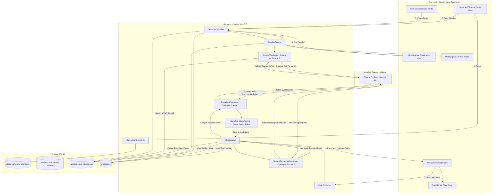
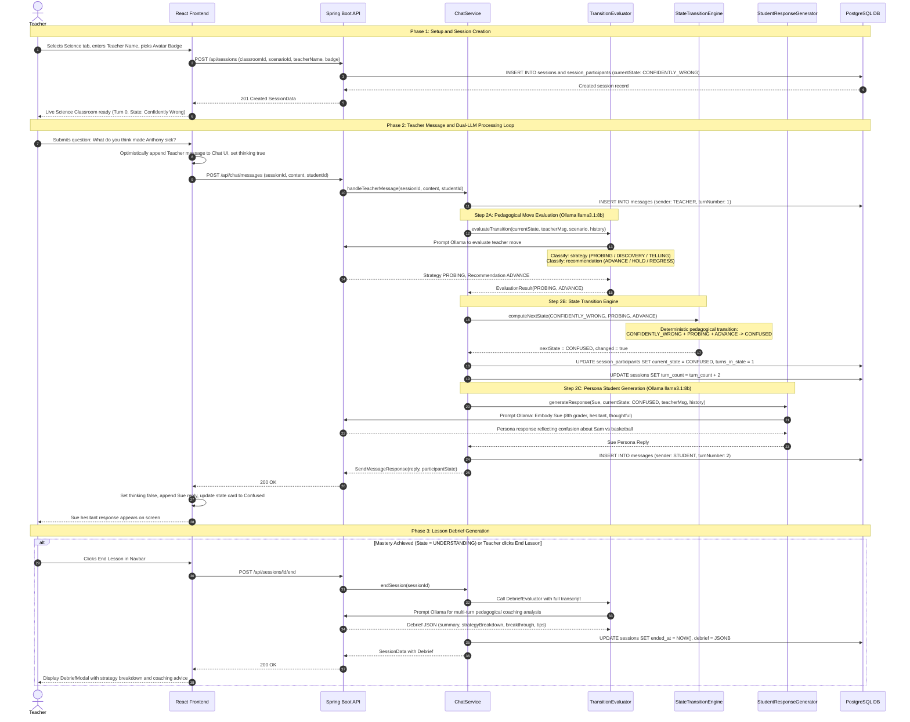
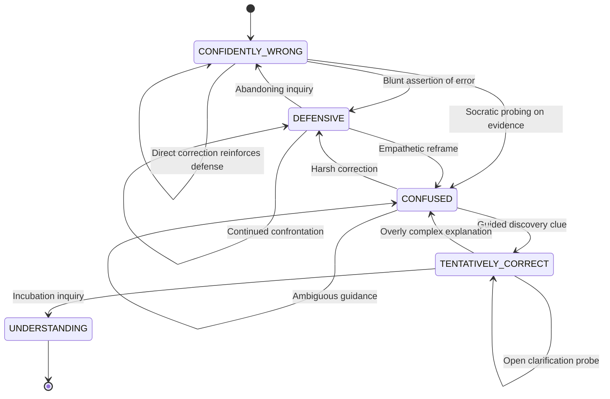

# Science Classroom — End-to-End Flow & Sequence Diagrams

> 💡 **How to view these diagrams in the IDE:**  
> Press **`Cmd + Shift + V`** (macOS) or click the **"Open Preview to the Side"** icon (split window icon in the top-right corner of the editor) to render the visual diagrams.  
> Alternatively, open the interactive browser viewer: [**`flow diagrams/science/index.html`**](file:///Users/sanket/Desktop/Opi%20/student-ai-project/flow%20diagrams/science/index.html)

This directory contains the complete end-to-end flow and sequence diagrams for the **Science Classroom** module in Student AI. It visualizes the entire system lifecycle across the React frontend, Spring Boot backend, PostgreSQL persistence, and Ollama (`llama3.1:8b`) dual-prompt pipeline.

---

## 1. High-Level Architecture Flowchart

The diagram below illustrates how data and control flow across the system during a teaching session.

---

## 2. Complete End-to-End Sequence Diagram

This sequence diagram details every message exchange, database query, and LLM prompt call from initial setup to debrief assessment.

---

## 3. Sue's Cognitive State Machine (`StudentMentalModel`)

The science scenario models an 8th-grade student ("Sue") moving from a common intuitive misconception (*"Anthony got sick because he got exhausted playing basketball in the cold"*) to scientific causality (*"Anthony was infected with a cold virus transmitted from Sam, which had an incubation delay"*).

---

## 4. Key Components and Responsibilities

| Component | Technology | Primary Responsibility |
|---|---|---|
| `TeacherSetupView` | React / TS | Hero banner, teacher identity selection, classroom subject picker (`Science`, `Math`). |
| `ClassroomView` | React / TS | Two-column live interactive classroom layout, toolbar controls, debrief modal management. |
| `StudentProfileCard` | React / TS | Real-time visual indicator of Sue's mental state, bio, thinking animation, turn count in state. |
| `ChatMessages` & `ChatInput` | React / TS | Live dialogue stream with role badges, auto-scroll, and teacher prompt dispatch. |
| `DebriefModal` | React / TS | Pedagogical coaching modal showing teaching strategy % (Probing, Discovery, Telling), turning points, and tips. |
| `PastConversationsModal` | React / TS | Searchable multi-tiered dialog for filtering past sessions by classroom and teacher. |
| `ChatService` | Spring Boot | Coordinates message persistence, evaluation call, state machine transition, and response generation. |
| `TransitionEvaluator` | Spring AI | Prompts Ollama with teacher message and rubric to classify strategy and transition recommendation. |
| `StateTransitionEngine` | Java / Core | Pure deterministic state machine determining state transitions based on pedagogical rules. |
| `StudentResponseGenerator` | Spring AI | Prompts Ollama to roleplay Sue adhering to persona constraints (hesitant, 8th grade voice, current state). |
| `DebriefEvaluator` | Spring AI | Evaluates completed session dialogue to compute pedagogical analytics and personalized growth tips. |
| `PostgreSQL 16` | PostgreSQL / Flyway | Stores structured relational data (`classrooms`, `scenarios`, `students`, `sessions`, `messages`) with JSONB debrief. |
