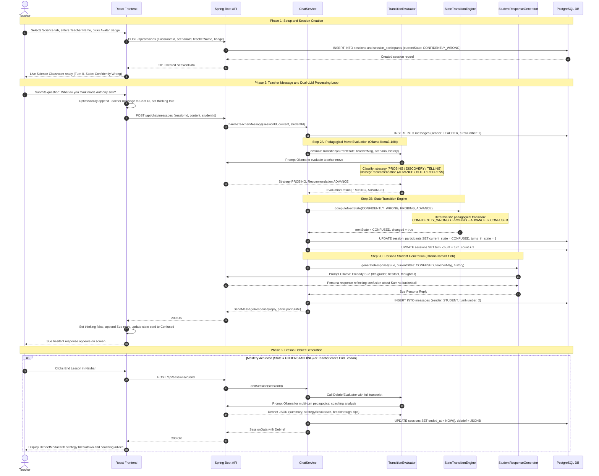

# Science Classroom — Detailed Sequence Diagram

> 💡 **How to view this diagram in the IDE:**  
> Press **`Cmd + Shift + V`** (macOS) or click the **"Open Preview to the Side"** icon (split editor icon in the top-right corner of this tab) to render the visual sequence diagram.  
> Alternatively, open the interactive dashboard in your browser: [**`flow diagrams/science/index.html`**](file:///Users/sanket/Desktop/Opi%20/student-ai-project/flow%20diagrams/science/index.html)

---

