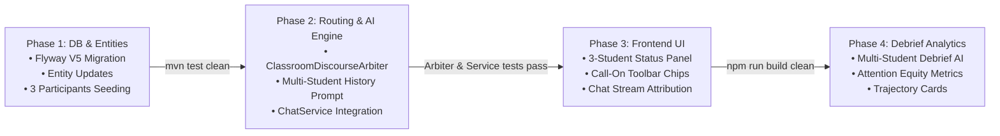

# Multi-Student Science Classroom — Phased Implementation Plan (v2)

**Project:** Student AI Project (`student-ai-project`)  
**Design Reference:** [**`design.md`**](file:///Users/sanket/Desktop/Opi%20/student-ai-project/design.md) (Version 2.0.0)  
**Objective:** Incrementally implement the 3-student classroom (*Marcus, Lena, Sue*) in clean, testable, reviewable phases adhering strictly to existing architectural and coding standards.

---

## Architecture Standards & Conventions Checklist

To maintain codebase consistency, all phases must adhere to these established patterns:

### Backend Conventions (Spring Boot 3.5 / Java 17 / Spring AI)
- **Layer Separation:** `Controller` $\rightarrow$ `Service` $\rightarrow$ `Repository` $\rightarrow$ `Entity`.
- **Lombok Usage:** `@Getter`, `@Setter`, `@Builder`, `@NoArgsConstructor`, `@AllArgsConstructor`, `@RequiredArgsConstructor`, `@Slf4j`.
- **DTOs:** Request objects use Bean Validation annotations (`@Valid`, `@NotBlank`, `@NotNull`), responses use `@Value` or `@Builder`.
- **Database Evolution:** All database mutations happen via versioned Flyway scripts (`V{N}__{name}.sql`) with idempotent constraints (`IF NOT EXISTS`, `ON CONFLICT DO NOTHING / UPDATE`).
- **Persistence Auditing:** Entities use UUID primary keys with `@GeneratedValue(strategy = GenerationType.UUID)` and `Instant` timestamps (`@CreationTimestamp`).
- **Exception Handling:** Domain conflicts throw custom exceptions (`ResourceNotFoundException`, `SessionStateConflictException`, `AiServiceUnavailableException`) handled globally by `GlobalExceptionHandler`.
- **Testing:** Unit and slice tests use JUnit 5 with descriptive `@DisplayName` annotations, parameterized tests where appropriate, and Mockito for service isolation.

### Frontend Conventions (React 19 / TypeScript 5.7 / Vite 6)
- **CSS Architecture:** Component-scoped CSS Modules (`[Component].module.css`) + shared tokens in `variables.css`. No inline style clutter; no Tailwind.
- **Testing Attributes:** Interactive controls and cards require unique, descriptive HTML `id` attributes (e.g. `id="btn-call-marcus"`, `id="student-card-lena"`).
- **Type Safety:** All API payloads and domain structures mirrored in `src/types/index.ts`. No `any` types.
- **Network Resilience:** API calls route through `src/api/client.ts` with error interceptors and `notificationHub` toasts.
- **Theme Support:** Clean contrast in both Light and Dark modes using CSS custom properties (`--bg-primary`, `--surface-card`, etc.).

---

## Phase 1: Database Migration & Multi-Participant Seeding

### 1.1 Goal
Upgrade the PostgreSQL database schema and JPA domain model to support multiple enrolled students, distinct initial cognitive states, participation weights, and turn-by-turn routing audit trails.

### 1.2 Target Files
| File | Action | Purpose |
|---|---|---|
| [`backend/src/main/resources/db/migration/V5__multi_student_architecture.sql`](file:///Users/sanket/Desktop/Opi%20/student-ai-project/backend/src/main/resources/db/migration) | **Create** | Flyway migration adding schema columns, seeding Marcus & Lena, enrolling them in Science classroom, and setting 3 distinct mental models. |
| [`ddl/schema.sql`](file:///Users/sanket/Desktop/Opi%20/student-ai-project/ddl/schema.sql) | **Update** | Synchronize DDL documentation file with V5 changes. |
| [`backend/src/main/java/com/studentai/project/student/Student.java`](file:///Users/sanket/Desktop/Opi%20/student-ai-project/backend/src/main/java/com/studentai/project/student/Student.java) | **Modify** | Add `participationWeight` (Integer) and `speakingStyle` (String) fields. |
| [`backend/src/main/java/com/studentai/project/student/StudentMentalModel.java`](file:///Users/sanket/Desktop/Opi%20/student-ai-project/backend/src/main/java/com/studentai/project/student/StudentMentalModel.java) | **Modify** | Add `initialState` (`StudentState`) and `targetConcept` (String) fields. |
| [`backend/src/main/java/com/studentai/project/session/SessionParticipant.java`](file:///Users/sanket/Desktop/Opi%20/student-ai-project/backend/src/main/java/com/studentai/project/session/SessionParticipant.java) | **Modify** | Add `turnsSpoken` (int), `lastSpokeAtTurn` (Integer), and helper `recordTurnSpoken(int turnNumber)`. |
| [`backend/src/main/java/com/studentai/project/message/Message.java`](file:///Users/sanket/Desktop/Opi%20/student-ai-project/backend/src/main/java/com/studentai/project/message/Message.java) | **Modify** | Add `targetStudent` (`Student`), `referencedStudent` (`Student`), `routingReason` (String), and `studentStateSnapshot` (`StudentState`). |
| [`backend/src/main/java/com/studentai/project/session/SessionService.java`](file:///Users/sanket/Desktop/Opi%20/student-ai-project/backend/src/main/java/com/studentai/project/session/SessionService.java) | **Modify** | Update `createSession()` to seat all enrolled students with their individual `initialState` (Marcus: `CONFIDENTLY_WRONG`, Lena: `CONFUSED`, Sue: `TENTATIVELY_CORRECT`). |
| DTOs: `StudentSummaryResponse.java`, `SessionParticipantResponse.java`, `MessageResponse.java` | **Modify** | Expose the new fields in API responses. |
| Student avatar assets (`avatar_marcus.png`, `avatar_lena.png`) | **Create** | Add avatar images to `frontend/public/images/`. |

### 1.3 Detailed Changes
1. **Flyway Script:**
   - Add `participation_weight INT NOT NULL DEFAULT 40` and `speaking_style TEXT` to `student`.
   - Add `initial_state VARCHAR(30) NOT NULL DEFAULT 'CONFIDENTLY_WRONG'` and `target_concept TEXT` to `student_mental_model`.
   - Add `turns_spoken INT NOT NULL DEFAULT 0` and `last_spoke_at_turn INT` to `session_participant`.
   - Add `target_student_id UUID`, `referenced_student_id UUID`, `routing_reason VARCHAR(50)`, and `student_state_snapshot VARCHAR(30)` to `message`.
   - Insert Marcus (40% weight, energetic) and Lena (20% weight, quiet).
   - Enroll both in Science Classroom (`00000000-0000-0000-0000-000000000001`).
   - Insert Marcus's mental model (`CONFIDENTLY_WRONG`), Lena's mental model (`CONFUSED`), and update Sue's (`TENTATIVELY_CORRECT`).
2. **Session Initialization:**
   - In `SessionService.createSession()`, instead of hardcoding `CONFIDENTLY_WRONG`, assign:
     `currentState = (mentalModel != null && mentalModel.getInitialState() != null) ? mentalModel.getInitialState() : StudentState.CONFIDENTLY_WRONG`.

### 1.4 Verification & Acceptance Criteria
- Run `mvn clean test` in `backend/`: all existing tests pass; Flyway migration executes without SQL syntax errors.
- Run `mvn test -Dtest=SessionServiceTest`: verifies that creating a session in the Science classroom seats 3 distinct participants with initial states:
  - Marcus $\rightarrow$ `CONFIDENTLY_WRONG`
  - Lena $\rightarrow$ `CONFUSED`
  - Sue $\rightarrow$ `TENTATIVELY_CORRECT`

---

## Phase 2: Discourse Routing & Turn Arbitration Engine

### 2.1 Goal
Implement the 5-tier deterministic `ClassroomDiscourseArbiter`, update prompt generation for multi-agent peer awareness, and wire the single-speaker turn loop into `ChatService`.

### 2.2 Target Files
| File | Action | Purpose |
|---|---|---|
| `backend/src/main/java/com/studentai/project/chat/ClassroomDiscourseArbiter.java` | **Create** | Implements 5-tier routing logic: UI manual selection, direct peer invitation, peer exclusion query, vocative direct address, and weighted open-class draw with recency damping. |
| `backend/src/main/java/com/studentai/project/chat/dto/ArbitrationResult.java` | **Create** | DTO encapsulating `SessionParticipant targetParticipant`, `String routingReason`, and `String referencedPeerName`. |
| `backend/src/test/java/com/studentai/project/chat/ClassroomDiscourseArbiterTest.java` | **Create** | Thorough unit test suite validating all 5 tiers, name matching variations, and recency damping. |
| [`backend/src/main/java/com/studentai/project/ai/PromptBuilder.java`](file:///Users/sanket/Desktop/Opi%20/student-ai-project/backend/src/main/java/com/studentai/project/ai/PromptBuilder.java) | **Modify** | Format conversation history with exact speaker names (`Marcus:`, `Lena:`, `Sue:`), inject peer roster, and add strict non-conformity rules. |
| [`backend/src/main/java/com/studentai/project/ai/StudentResponseGenerator.java`](file:///Users/sanket/Desktop/Opi%20/student-ai-project/backend/src/main/java/com/studentai/project/ai/StudentResponseGenerator.java) | **Modify** | Update sanitization to strip speaker prefixes for Marcus and Lena as well as Sue. |
| [`backend/src/main/java/com/studentai/project/chat/ChatService.java`](file:///Users/sanket/Desktop/Opi%20/student-ai-project/backend/src/main/java/com/studentai/project/chat/ChatService.java) | **Modify** | Integrate `ClassroomDiscourseArbiter`, evaluate teacher move for target student, advance that student's state machine, increment `turnsSpoken`, and generate persona response. |
| [`backend/src/main/java/com/studentai/project/chat/dto/ChatSendResponse.java`](file:///Users/sanket/Desktop/Opi%20/student-ai-project/backend/src/main/java/com/studentai/project/chat/dto/ChatSendResponse.java) | **Modify** | Return `MessageResponse reply`, `List<SessionParticipantResponse> allParticipants`, `String routedStudentName`, and `String routingReason`. |
| [`backend/src/main/java/com/studentai/project/chat/ChatController.java`](file:///Users/sanket/Desktop/Opi%20/student-ai-project/backend/src/main/java/com/studentai/project/chat/ChatController.java) | **Modify** | Ensure `SendMessageRequest` accepts optional `targetStudentId`. |

### 2.3 Detailed Changes
1. **Routing Logic (ClassroomDiscourseArbiter):**
   - Tier 1: `explicitTargetStudentId != null` $\rightarrow$ Target selected student (`MANUAL_TEACHER_SELECTION`).
   - Tier 2: `[Name], what do you think of [Peer]` $\rightarrow$ Target invited student, flag referenced peer.
   - Tier 3: `Does anyone agree with [Peer]?` $\rightarrow$ Exclude mentioned peer; pick from remaining two.
   - Tier 4: `[Name], why did Anthony...` $\rightarrow$ Direct vocative target.
   - Tier 5: Open question $\rightarrow$ Weighted draw: Marcus (40%), Sue (40%), Lena (20%), penalizing whoever spoke on the immediate prior turn.
2. **Prompt Construction:**
   - In `PromptBuilder.buildConversationHistory()`, format speaker dynamically:
     `String speaker = msg.getSenderType() == SenderType.TEACHER ? "Teacher" : (msg.getStudent() != null ? msg.getStudent().getName() : "Student");`
   - In `PromptBuilder.buildSystemPrompt()`, inject peer awareness section:
     *"You are sitting in class with Marcus, Lena, and Sue. You do NOT automatically agree with peer statements. Process peer ideas through your own understanding."*
3. **Execution Loop in ChatService:**
   - Resolve single target student via arbiter.
   - Evaluate teacher move against target student's misconception.
   - Compute state transition for target student only.
   - Generate response from target student with peer awareness.
   - Persist messages and updated participant metrics (`turnsSpoken++`, `lastSpokeAtTurn`).
   - Return reply plus updated array of all 3 student states.

### 2.4 Verification & Acceptance Criteria
- Run `mvn test -Dtest=ClassroomDiscourseArbiterTest`: validates:
  - *"Marcus, what do you think?"* routes to Marcus.
  - *"Does anyone agree with Marcus?"* routes to Lena or Sue (never Marcus).
  - *"Sue, what do you think about Marcus's point?"* routes to Sue with Marcus flagged as peer.
  - Open question routes with 40/20/40 distribution.
- Run `mvn test`: all backend tests pass in $< 3$ seconds.

---

## 3. Phase 3: Frontend Multi-Student Discourse UI

### 3.1 Goal
Upgrade the React interface to present all 3 students simultaneously with real-time cognitive state indicators, provide the Teacher Call-On Toolbar, and display distinct chat bubbles for each student.

### 3.2 Target Files
| File | Action | Purpose |
|---|---|---|
| [`frontend/src/types/index.ts`](file:///Users/sanket/Desktop/Opi%20/student-ai-project/frontend/src/types/index.ts) | **Modify** | Add `turnsSpoken`, `lastSpokeAtTurn`, `participationWeight` to `SessionParticipant`; add routing metadata to `ChatMessage` and `ChatSendResponse`. |
| `frontend/src/components/ClassroomRosterPanel.tsx` and `.module.css` | **Create** | Displays Marcus, Lena, and Sue side-by-side or stacked with avatars, personality blurbs, live state badges, turn counts, and thinking pulse glow. |
| [`frontend/src/components/ChatInput.tsx`](file:///Users/sanket/Desktop/Opi%20/student-ai-project/frontend/src/components/ChatInput.tsx) and `.module.css` | **Modify** | Add Teacher Call-on Toolbar chips: `[✨ Auto]`, `[👦 Marcus]`, `[👧 Lena]`, `[👩 Sue]`. Passes `targetStudentId` in payload. |
| [`frontend/src/components/ChatMessages.tsx`](file:///Users/sanket/Desktop/Opi%20/student-ai-project/frontend/src/components/ChatMessages.tsx) and `.module.css` | **Modify** | Render each student's message with their specific avatar, colored name badge, and state badge pill at the time of speaking. |
| [`frontend/src/views/ClassroomView.tsx`](file:///Users/sanket/Desktop/Opi%20/student-ai-project/frontend/src/views/ClassroomView.tsx) | **Modify** | Replace single `StudentProfileCard` with `ClassroomRosterPanel`; synchronize all 3 student states on each incoming chat response. |
| [`frontend/src/api/client.ts`](file:///Users/sanket/Desktop/Opi%20/student-ai-project/frontend/src/api/client.ts) | **Modify** | Ensure `SendMessagePayload` forwards `targetStudentId` when provided. |

### 3.3 Detailed Changes
1. **Classroom Roster Panel:**
   - 3 distinct student cards:
     - **Marcus:** 🔴 Confidently Wrong (`40%` participation, turns spoken counter).
     - **Lena:** 🟡 Confused (`20%` participation, turns spoken counter).
     - **Sue:** 🔵 Tentatively Correct (`40%` participation, turns spoken counter).
   - When a student is thinking, their card pulses with `animate-thinking-glow`.
2. **Teacher Call-On Toolbar:**
   - Positioned directly above the chat textarea.
   - Clicking a chip toggles manual targeting: e.g. clicking `[@Lena]` forces the next question to target Lena, allowing the teacher to purposefully bring her into the conversation.
3. **Chat Stream:**
   - Bubbles show: Avatar + Student Name + State Badge (e.g. `Marcus · Confidently Wrong`).
   - Distinguishes peer references with subtle quote styling if applicable.

### 3.4 Verification & Acceptance Criteria
- Run `npm run build` in `frontend/`: TypeScript compiler (`tsc -b`) and Vite production bundle pass with **zero errors**.
- Interactive verification:
  - Teacher setup screen loads Science Classroom with 3 enrolled students.
  - Active classroom shows 3 student cards.
  - Typing *"Marcus, what do you think?"* shows Marcus thinking glow and renders Marcus's reply.
  - Clicking `[@Lena]` chip and asking *"What do you think?"* routes to Lena.

---

## 4. Phase 4: Multi-Student Debrief & Attention Equity Analytics

### 4.1 Goal
Upgrade post-lesson evaluation to assess individual student breakthroughs, whole-classroom dynamics, and teacher attention equity across all 3 students.

### 4.2 Target Files
| File | Action | Purpose |
|---|---|---|
| [`backend/src/main/java/com/studentai/project/ai/DebriefData.java`](file:///Users/sanket/Desktop/Opi%20/student-ai-project/backend/src/main/java/com/studentai/project/ai/DebriefData.java) | **Modify** | Expand schema to include `Map<String, StudentProgressSummary> studentOutcomes` and `Map<String, Integer> equityBreakdown`. |
| [`backend/src/main/java/com/studentai/project/ai/DebriefEvaluator.java`](file:///Users/sanket/Desktop/Opi%20/student-ai-project/backend/src/main/java/com/studentai/project/ai/DebriefEvaluator.java) | **Modify** | Update Ollama prompt to analyze multi-student transcript: individual breakthroughs for Marcus, Lena, and Sue, plus equity percentage breakdown. |
| [`backend/src/main/java/com/studentai/project/session/SessionService.java`](file:///Users/sanket/Desktop/Opi%20/student-ai-project/backend/src/main/java/com/studentai/project/session/SessionService.java) | **Modify** | Pass all 3 participants and their final cognitive states into `debriefEvaluator.generateDebrief()`. |
| [`frontend/src/components/DebriefModal.tsx`](file:///Users/sanket/Desktop/Opi%20/student-ai-project/frontend/src/components/DebriefModal.tsx) and `.module.css` | **Modify** | Display 3 side-by-side Student Trajectory Cards, Attention Equity stacked bar (Marcus vs Sue vs Lena vs target), and classroom management advice. |

### 4.3 Detailed Changes
1. **Debrief Evaluation Prompt:**
   - Prompts Ollama with the full transcript containing Marcus, Lena, Sue, and Teacher.
   - Evaluates:
     - **Marcus Trajectory:** Initial `CONFIDENTLY_WRONG` $\rightarrow$ Final state. Breakthrough moment identified.
     - **Lena Trajectory:** Initial `CONFUSED` $\rightarrow$ Final state. Breakthrough moment identified.
     - **Sue Trajectory:** Initial `TENTATIVELY_CORRECT` $\rightarrow$ Final state. Breakthrough moment identified.
     - **Attention Equity:** Percentage of turns addressed to Marcus, Lena, and Sue (compared against 40/20/40 target).
     - **Classroom Coaching:** Advice on facilitating group discourse (e.g. encouraging quieter students, managing talkative students).
2. **Debrief Modal UI:**
   - Shows 3 individual progress cards:
     - 👦 **Marcus:** Start: 🔴 $\rightarrow$ End: 🟡 (Progress!)
     - 👧 **Lena:** Start: 🟡 $\rightarrow$ End: 🟢 (Breakthrough!)
     - 👩 **Sue:** Start: 🔵 $\rightarrow$ End: 🟢 (Mastery!)
   - Visual Attention Equity bar chart.
   - Classroom facilitator coaching tips.

### 4.4 Verification & Acceptance Criteria
- Run `mvn test` in `backend/`: all unit and integration tests pass.
- Run `npm run build` in `frontend/`: compiles cleanly.
- End-to-end verification: Ending a lesson generates and displays the multi-student debrief modal with all 3 students evaluated.

---

## 5. Phase Dependency & Verification Summary

| Phase | Core Deliverable | Automated Test Command | Manual Verification |
|---|---|---|---|
| **Phase 1** | Schema migration + Entity models | `mvn test -Dtest=*Session*` | Verify 3 students seated with distinct initial states. |
| **Phase 2** | Discourse Arbiter + PromptBuilder | `mvn test -Dtest=ClassroomDiscourseArbiterTest` | Verify 5-tier routing and single speaker response. |
| **Phase 3** | Multi-Student UI + Call-on bar | `(cd frontend && npm run build)` | Test live chat in browser at `localhost:5173`. |
| **Phase 4** | Debrief + Attention Equity | `mvn test && (cd frontend && npm run build)` | Verify 3 student trajectory cards and equity chart. |

---

## Next Steps
We are ready to begin execution starting with **Phase 1: Database Migration & Multi-Participant Seeding**.
